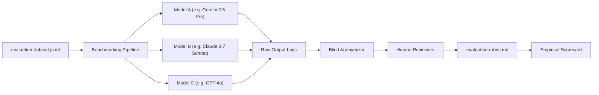

# A6 LLM Evaluation Methodology & Experimental Protocol

This document outlines the experimental framework for evaluating Large Language Models (LLMs) on software architecture, design pattern recognition, refactoring, and code generation within the A6 Case Study.

---

## 1. Experimental Design & Fairness Principles

To ensure scientific rigor, reproducibility, and unbiased evaluation across competing LLMs, experiments must follow strict fairness controls:

### 1.1 Identical Context Injection
* **Uniform Prompting:** Every evaluated model must receive the exact string input defined in [`A6/data/evaluation-dataset.jsonl`](file:///d:/design-patterns-case-study/A6/data/evaluation-dataset.jsonl) without system prompt variations that favor a specific vendor.
* **Controlled Source Context:** When prompts supply codebase excerpts, identical file windows (exact start and end line ranges from baseline commit `c8766f4`) must be provided to all models.

### 1.2 Controlled Generation Hyperparameters
* **Temperature:** Fixed at $T = 0.0$ (or minimum allowable value) to minimize stochastic drift during factual architectural extraction. For creative refactoring generation, a controlled $T = 0.2$ may be used across all runs.
* **Top-p / Nucleus Sampling:** Fixed at $p = 1.0$.
* **Max Output Tokens:** Standardized to 2,048 tokens to prevent truncation.

### 1.3 Repeated Sampling for Variance Estimation
* For non-zero temperature evaluations, each prompt must be sampled $N = 3$ times per model.
* Metrics must record pass rate ($\text{pass}@1$ and $\text{pass}@k$) rather than cherry-picking single anomalous successes.

### 1.4 Blind Human & Cross-Evaluation
* **Anonymization:** Evaluated outputs are stripped of model identifiers before human review.
* **Grading Protocol:** Human evaluators grade responses against [`A6/data/evaluation-rubric.md`](file:///d:/design-patterns-case-study/A6/data/evaluation-rubric.md) and [`A6/data/reference-answers.md`](file:///d:/design-patterns-case-study/A6/data/reference-answers.md).
* **Inter-Rater Reliability:** When multiple team members grade a task, scores are averaged, and discrepancies $> 1.0$ point require consensus adjudication.

---

## 2. Evaluation Tasks & Operational Definitions

The evaluation dataset exercises 8 core software engineering capabilities:

| Task ID | Task Category | Primary Dimension | Evaluation Criterion |
|---|---|---|---|
| `A6-EVAL-001` | Pattern Identification from Excerpt | Correctness (CR) | Accurate naming of DI, Repository, and Adapter. |
| `A6-EVAL-002` | Explaining Claims with Evidence | Grounding (EG) | Accurate mapping to authentic service adapter files. |
| `A6-EVAL-003` | Distinguishing Real Pattern from Resemblance | Reasoning (RJ) | Rejection of enum-only State pattern claims. |
| `A6-EVAL-004` | Recognizing Absent/Partial Patterns | Safety (SL) | Correct identification of procedural fare calculation. |
| `A6-EVAL-005` | Minimal Refactoring with Tradeoffs | Reasoning (RJ) | Balanced comparison of GoF vs XState vs DB checks. |
| `A6-EVAL-006` | Code Generation from Acceptance Criteria | Correctness (CR) | Compiling, clamped TypeScript Strategy pattern. |
| `A6-EVAL-007` | Cross-Language Equivalence | Consistency (CC) | Java vs C++ (RAII) vs Python (ABC) vs JS. |
| `A6-EVAL-008` | Detecting Unsupported Claims | Safety (SL) | 100% detection of non-existent test and refund logic. |

---

## 3. Evaluation Execution Pipeline

---

## 4. Reporting Constraints & Anti-Fabrication Rule

> [!IMPORTANT]
> **Anti-Fabrication Policy:** In compliance with empirical software engineering standards, no model scores, performance rankings, or statistical significance $p$-values are reported in this repository prior to conducting real, logged benchmarking runs.
>
> All unexecuted model records in [`A6/data/evaluation-dataset.jsonl`](file:///d:/design-patterns-case-study/A6/data/evaluation-dataset.jsonl) maintain `model_output: null` and `score: null` until genuine test sessions are executed.
